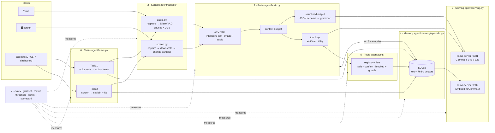

# Harness map

The diagram source below renders on GitHub, or paste it into https://mermaid.live to export a
slide image. Every box is one small file. The numbers are the Session 1 agenda segments.

## Where each segment lives

| Segment | Files | Eval (folder in `evals/`) |
|---|---|---|
| 0 Harness map, eval pattern | this file, `evals/common.py` | n/a |
| 1 Serving | `agent/config.py`, `agent/serving.py` | `serving` |
| 2 Senses | `agent/senses/audio.py`, `agent/senses/screen.py` | `vad`, `asr`, `screen` |
| 3 Brain | `agent/brain.py` | `structured`, `tool_calls` |
| 4 Memory v1 | `agent/memory/episodic.py` | `memory` |
| 5 Tools, CLI, hotkey | `agent/tools/`, `cli.py`, `agent/hotkey.py` | `tools` |
| 6 Live tasks | `agent/tasks.py` | `task1`, `task2` (end-to-end) |
| 7 Scorecard | `evals/run_all.py`, dashboard tab 7 | n/a |

Cross-cutting: `agent/events.py` (every component logs here, and the dashboard shows it) and
`dashboard/` (FastAPI + one HTML page).

## Data flow for one request

1. A sense produces raw input: a 16 kHz float array or a PIL image.
2. `brain.part()` turns it into an OpenAI-style content part (base64 WAV or PNG).
3. `brain.fit_budget()` adds the system prompt and the top 3 memories, estimates tokens
   (audio 25/s, image ~280, text ~chars/4) and drops old history if it does not fit.
4. `brain.send()` writes the exact request to `data/runtime/last_request.json`, logs it to the
   event log (the dashboard's Brain tab), and posts it to llama-server.
5. A reply with `tool_calls` goes through `tools.run()`: schema check → tier → guard → execute.
   The result goes back to the model as a `tool` message, and the loop runs again.
