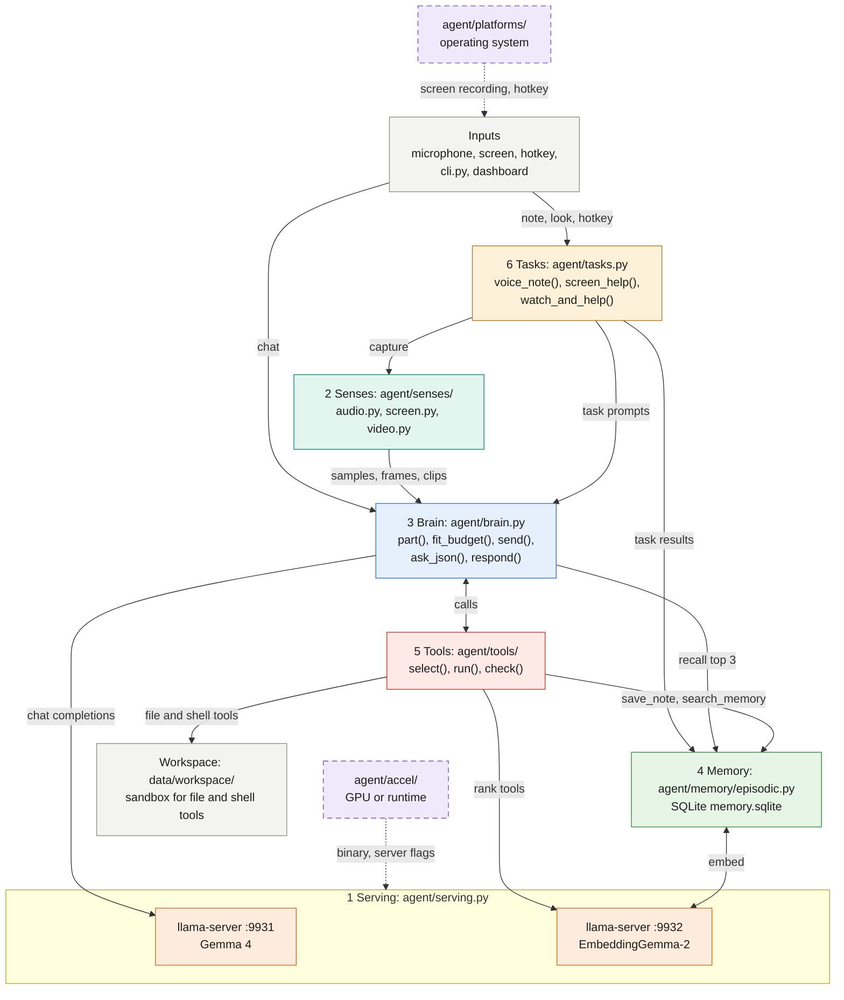

# multimodal-agent architecture

A personal agent that listens, sees, remembers and acts, entirely on the device. Inputs flow through senses and tasks
into the brain. The brain talks to a local `llama-server` running Gemma 4, with memory and a permissioned tool registry
on the side. The numbers in the diagram match the Session 1 segments in [Where each segment lives](#where-each-segment-lives).

## Diagram

Each box is one component, and [Components](#components) lists what is inside it. Dashed boxes and arrows are the
portability plug-ins.

## Components

### Inputs

| Input | What it gives |
| ----- | ------------- |
| Microphone | A live or recorded clip |
| Screen | A screenshot or a screen recording |
| Hotkey | A global key combination, ctrl+alt+space. The OS plug-in provides it. |
| CLI, `cli.py` | `serve`, `stop`, `dashboard`, `hotkey`, `note`, `look`, `chat`, `memory`, `record-clip`, `record-screen`, `smoke`, `doctor`, `evals` |
| Dashboard | FastAPI on port 8765 with 7 tabs: chat, memory, tool approval, model switch, benchmark, evals |

### 1 Serving: `agent/serving.py`

Start, stop, health, chat and embed.

| Server | Details |
| ------ | ------- |
| `llama-server` on port 9931 | Gemma 4 E4B (default) or E2B, Q4_0. The mmproj handles audio, image and video. 16k context. Video runs at 1 fps, decoded with ffmpeg. The GPU plug-in provides the binary and flags. |
| `llama-server` on port 9932 | EmbeddingGemma-2, 768-d vectors |

The dashboard watches both servers. It restarts a server whose process stops, on the current tier, unless `cli.py stop`
stopped it.

### 2 Senses: `agent/senses/`

| File | What it does |
| ---- | ------------ |
| `audio.py` | Capture and Silero VAD, with chunks up to 28 s |
| `screen.py` | Downscale to at most 1280 px, and check for a flat image |
| `video.py` | Record a clip and shrink it to 640 px, as a 1 fps video part. The OS plug-in records the screen. |

### 3 Brain: `agent/brain.py`

| Function | What it does |
| -------- | ------------ |
| `part()` | Turns text, image, audio or video into OpenAI-style parts |
| `fit_budget()` | Adds the prompt, the top 3 memories and the tool schemas. Drops old history, then memories. |
| `send()` | Posts to `llama-server`, and logs the exact request to `last_request.json` and the `brain.request` event |
| `ask_json()` | Structured output: a JSON schema becomes a grammar. Validates, and retries once. |
| `respond()` | The tool loop, up to 4 steps. A bad call is asked again, up to 2 retries. Thinking is on after a tool result. |

Both `ask_json()` and `respond()` run the `part()`, `fit_budget()`, `send()` pipeline. Tasks call `ask_json()`. `cli.py
chat` and `/api/chat` call `respond()` directly.

### 4 Memory: `agent/memory/episodic.py`

SQLite in `memory.sqlite`, with text and 768-d vectors. It stores and searches (top 3). The junk filter drops text that is
too short or nearly a duplicate.

### 5 Tools: `agent/tools/`

`tools.select()` embeds the request, ranks the tools by description and examples, and offers the top 5 only. `tools.run()`
calls `check()`: schema, tier, guard, then execute.

| Tier | Tools |
| ---- | ----- |
| Safe | `get_time`, `calculator`, `save_note`, `search_memory`, `list_files`, `read_file` |
| Confirm (approved in the dashboard) | `write_file`, `run_shell` |
| Blocked | `delete_file` |

The file and shell tools work in the sandbox `data/workspace/`, set by `AGENT_WORKSPACE` and ignored by Git. The path
guard keeps them inside the sandbox. The shell guard blocks risky commands.

### 6 Tasks: `agent/tasks.py`

| Task | What it does |
| ---- | ------------ |
| Task 1, `voice_note()` | Voice note to summary and action items. The result is stored in memory. |
| Task 2, `screen_help()` and `watch_and_help()` | Screen (image or video) to an explanation and a fix. The result is stored in memory. |

### Cross-cutting and quality

| Part | What it does |
| ---- | ------------ |
| `agent/events.py` | `events.emit(kind, ...)` from every component. An in-memory ring plus `data/runtime/events.jsonl`. The dashboard polls `/api/events`. |
| `evals/` (7 Scorecard) | 10 components: `serving`, `vad`, `asr`, `screen`, `structured`, `tool_calls`, `memory`, `tools`, `task1`, `task2`. Synthetic cases and your cases in `data/evals/`, scored against `config.THRESHOLDS`. |
| `scripts/` | `setup.py` downloads and verifies pinned assets. `doctor.py` detects the OS and GPU and checks hooks. `smoke_test.py` runs end to end with real models. Run them through `cli.py doctor`, `smoke` and `evals`. |
| `tests/` and gates | `unittest` contract tests with no model and no GPU. `ruff check` and `ruff format`, `pyright`, `complexipy`. `test_plugin_contract.py` keeps OS and GPU code out of core modules. |

## Where each segment lives

| Segment | Files | Eval (folder in `evals/`) |
| ------- | ----- | ------------------------- |
| 0 Harness map, eval pattern | This page, `agent/events.py`, `evals/common.py`, `evals/cases.py`, `evals/synthetic/` | n/a |
| 1 Serving | `agent/config.py`, `agent/serving.py` | `serving` |
| 2 Senses | `agent/senses/audio.py`, `agent/senses/screen.py`, `agent/senses/video.py` | `vad`, `asr`, `screen` |
| 3 Brain | `agent/brain.py` | `structured`, `tool_calls` |
| 4 Memory v1 | `agent/memory/episodic.py` | `memory` |
| 5 Tools, CLI, hotkey | `agent/tools/`, `cli.py`, `agent/hotkey.py` | `tools` |
| 6 Live tasks | `agent/tasks.py` | `task1`, `task2` (end-to-end) |
| 7 Scorecard | `evals/run_all.py`, dashboard tab 7 | n/a |

## Portability layer

Everything that differs by OS or GPU sits behind two plug-in folders. The agent chooses the plug-in at start-up. Core code
never branches on the OS. See [PLATFORMS.md](PLATFORMS.md).

| Folder | Axis | Decides |
| ------ | ---- | ------- |
| `agent/platforms/<os>.py` | Operating system | Screen recording, speech synthesis, hotkey listener and permissions, install hints, `.exe` suffix, venv path |
| `agent/accel/<backend>.py` | GPU or runtime | Which llama.cpp build to download and its checksum, extra `llama-server` flags, how to measure server memory |
| `agent/pins.py` | Neither | Model weights and VAD checksums (same on every machine) |

Each plug-in folder holds a contract, a verified reference and a template:

| Folder | Contract | Verified reference | Template | Hooks |
| ------ | -------- | ------------------ | -------- | ----- |
| `agent/accel/` | `base.py`, `Accelerator` | `metal.py`, Apple Silicon | `_template.py`, for CUDA, Vulkan or CPU | `download_for`, `server_args`, `server_memory_gb` |
| `agent/platforms/` | `base.py`, `Platform` and `Unsupported` | `macos.py` | `_template.py`, for Linux or Windows | `record_screen`, `synthesize_speech`, `start_hotkey` |

Shared configuration: `config.py` holds ports, thresholds, paths and knobs, and `config.LLAMA_BUILD` pins the llama.cpp
build. `pins.py` holds the sha256 of the model and VAD weights. The environment variables are `AGENT_TIER`,
`AGENT_WORKSPACE`, `AGENT_PLATFORM` and `AGENT_ACCEL`.

## Data flow for one request

1. A sense produces raw input: a 16 kHz float array, a PIL image or a video file.
2. `brain.part()` turns it into an OpenAI-style content part (base64 WAV, PNG or MP4).
3. For a chat turn, `brain.respond()` calls `tools.select()`. It embeds the request with the embedding server and ranks
   every tool by its description plus example requests. Only the top 5 tool schemas go into the request. If the embedding
   server is down, the first 5 registered tools are used.
4. `brain.fit_budget()` adds the system prompt, the top 3 memories and the tool schemas. It estimates tokens: audio at 25
   per second, an image at pixels / 2304 (up to 1,120), a video at frames x image, text at chars / 4. If the request does
   not fit, it drops the oldest history first, then the memories.
5. `brain.send()` writes the exact request to `data/runtime/last_request.json`, logs it to the event log, and posts it to
   `llama-server`.
6. A reply with `tool_calls` goes through `tools.run()`: schema check, tier, guard, execute. The result returns to the
   model as a `tool` message and the loop runs again, with thinking turned on from the second step (a Gemma 4 quirk: with
   thinking off, the reply after a tool result comes back empty).
   - A `confirm` call returns `pending` and ends the turn with a reply that the code writes, because the model claimed the
     call was done. While it waits, the system prompt names it. The model does not reply when the user decides. The
     dashboard adds the outcome (`brain.approval_note()`) to the chat history, so the next request tells the model what
     happened.
   - A `blocked` call never runs.
   - When the retries for invalid calls run out, the loop stops and says so.
